# C. Navigation and flows (SF-159)

The Fighter app's five tabs, every destination reachable from them, and the
key flows. Route facts come from `docs/route-registry.json` (mobile copy) and
the route files in `src/app/`. Design facts come from `FlowFighter.dc.html`,
`FighterTabs.dc.html` and the boards in [Artifact A](a-design-inventory.md).

## Shared rules

- **Shell.** `mobile.fighter` has five nav items: `home` → `mobile.home`,
  `training` → `mobile.training`, `board` → `mobile.board` (raised centre),
  `community` → `mobile.community`, `profile` → `mobile.profile`
  (`src/widgets/shell-tabs/model/navigation.ts`, `center: "board"`). Icons:
  House, Timer, Waypoints, Users, User.
- **Auth.** Every fighter and shared destination below has registry
  `access.session = AUTHENTICATED`. `SessionGate`
  (`src/features/session-gate/ui/session-gate.tsx`) sends a signed-out user
  to `/login?returnTo=…`. A network failure shows `SessionFailure` and does
  not sign out.
- **User context.** Routes in the `(fighter)` group have
  `access.capability = FIGHTER`, `phase = ACTIVE`. `CapabilityGate` in
  `(fighter)/_layout.tsx` renders only when `resolveMyEntry`
  (`GET /api/v1/me/entry`) reports `FIGHTER`; otherwise it redirects to where
  entry resolution sends the user. Routes in `(shared)` (settings, messages,
  notifications, search, checkout, `/me/gyms/**`) are guarded by `SessionGate`
  only, with no capability.
- **Deep links.** `simplefit://<canonical path>` opens any built route; route
  groups never appear in URLs; unknown paths and `/sparring/find` land on
  `+not-found`. Every URL passes `src/app/+native-intent.tsx` (SF-80). Universal
  and App Links exist only for `/invite/coach` and `/invite/gym`, and only when
  `EXPO_PUBLIC_APP_LINK_HOST` is set (`app.config.ts`). There is no per-route
  deep-link declaration. A deep link to a placeholder route opens the
  "Planned" placeholder.
- **Restricted accounts.** `mobile.account.suspended` and
  `mobile.account.pending-deletion` are registry restricted-account
  destinations, and `sanitizeReturnTo` never returns to them. No code
  navigates to them today; `SessionGate` says restricted-account rules are not
  resolved client-side, and mobile has no reference to `account_suspended`.
- **States.** Built screens declare loading, empty, error and not-available
  states. Placeholders have none. 105 of 109 fighter-mobile boards draw no
  loading, empty or error state (see [Artifact H](h-decisions-blockers.md)).

Column key for the tables below: **Deep link** = reachable by
`simplefit://<path>` (Y for every built or placeholder route). **Context** =
FIGHTER via `CapabilityGate`, or "session only". **Backend** = the capability
that serves the data. **States** = what the built screen handles; "none" for
placeholders.

## Tab bar

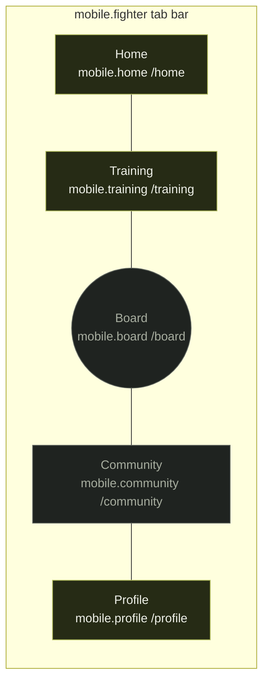

Home and Training are real screens. Profile is partial. Board and Community
are placeholders.

## 1. Home

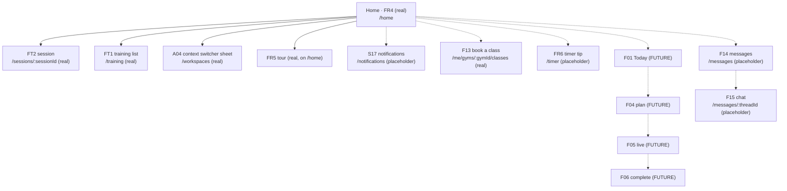

| Destination             | Route id                     | Path                  | Parent            | Deep link | Auth          | Context      | Backend                                                                      | States                                                                                   | Implemented | Design ref           |
| ----------------------- | ---------------------------- | --------------------- | ----------------- | --------- | ------------- | ------------ | ---------------------------------------------------------------------------- | ---------------------------------------------------------------------------------------- | ----------- | -------------------- |
| Home (MVP)              | `mobile.home`                | `/home`               | — (tab root)      | Y         | AUTHENTICATED | FIGHTER      | `getMyFighterProfile`, `listMyFirstRunExperiences`, `listMyTrainingSessions` | loading, error, first-run pending → tour, training card skeleton/empty/error/unavailable | IMPLEMENTED | FR4, FR5             |
| Today (where to go)     | `mobile.home`                | `/home`               | —                 | Y         | AUTHENTICATED | FIGHTER      | none (camp, weight, notes)                                                   | none                                                                                     | FUTURE      | F01                  |
| Home · schedule updated | `mobile.home`                | `/home`               | —                 | Y         | AUTHENTICATED | FIGHTER      | none (notifications)                                                         | none                                                                                     | BLOCKED     | F01b                 |
| Context switcher        | `mobile.workspaces`          | `/workspaces`         | —                 | Y         | AUTHENTICATED | session only | `resolveMyEntry`, `chooseMyEntryContext`                                     | pending, failed                                                                          | IMPLEMENTED | A04, ContextSwitcher |
| Notifications           | `mobile.notifications`       | `/notifications`      | —                 | Y         | AUTHENTICATED | session only | none                                                                         | none                                                                                     | BLOCKED     | S17                  |
| Messages                | `mobile.messages`            | `/messages`           | —                 | Y         | AUTHENTICATED | session only | none                                                                         | none                                                                                     | BLOCKED     | F14                  |
| Chat                    | `mobile.messages._thread-id` | `/messages/:threadId` | `mobile.messages` | Y         | AUTHENTICATED | session only | none                                                                         | none                                                                                     | BLOCKED     | F15                  |
| First-run milestone     | `mobile.home`                | `/home`               | —                 | Y         | AUTHENTICATED | FIGHTER      | `recordMyFirstRunOutcome` (UNVERIFIED fit)                                   | none                                                                                     | MISSING     | FR7                  |

Note: the registry nav for `mobile.messages` is `mobile.coach#inbox`; the
fighter shell has no Messages nav item. F14 is reached from F01 (FUTURE) and
F18 in the design.

## 2. Training

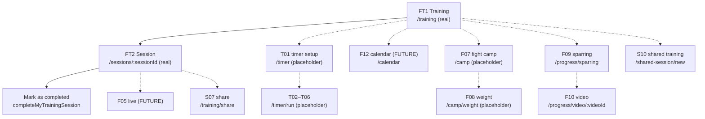

| Destination            | Route id                               | Path                                  | Parent                        | Deep link | Auth          | Context      | Backend                                             | States                                                         | Implemented | Design ref       |
| ---------------------- | -------------------------------------- | ------------------------------------- | ----------------------------- | --------- | ------------- | ------------ | --------------------------------------------------- | -------------------------------------------------------------- | ----------- | ---------------- |
| Training list          | `mobile.training`                      | `/training` (`?view=history&status=`) | — (tab root)                  | Y         | AUTHENTICATED | FIGHTER      | `listMyTrainingSessions`                            | loading, empty per view/filter, 404 not available, error, more | IMPLEMENTED | FT1 (F24 FUTURE) |
| Session detail         | `mobile.sessions._session-id`          | `/sessions/:sessionId`                | —                             | Y         | AUTHENTICATED | FIGHTER      | `getMyTrainingSession`, `completeMyTrainingSession` | loading, 404, error, offline, 409 not started / cancelled      | IMPLEMENTED | FT2 (F04 FUTURE) |
| Live training          | `mobile.sessions._session-id.live`     | `/sessions/:sessionId/live`           | `mobile.sessions._session-id` | Y         | AUTHENTICATED | FIGHTER      | none                                                | none                                                           | FUTURE      | F05              |
| Training complete      | `mobile.sessions._session-id.complete` | `/sessions/:sessionId/complete`       | `mobile.sessions._session-id` | Y         | AUTHENTICATED | FIGHTER      | none                                                | none                                                           | FUTURE      | F06              |
| Share training         | `mobile.training.share`                | `/training/share`                     | `mobile.training`             | Y         | AUTHENTICATED | FIGHTER      | none                                                | none                                                           | BLOCKED     | S07              |
| Timer setup            | `mobile.timer`                         | `/timer`                              | —                             | Y         | AUTHENTICATED | FIGHTER      | none needed                                         | none                                                           | MISSING     | T01, FR6         |
| Timer run              | `mobile.timer.run`                     | `/timer/run`                          | `mobile.timer`                | Y         | AUTHENTICATED | FIGHTER      | none needed                                         | none                                                           | MISSING     | T02–T06          |
| Calendar               | `mobile.calendar`                      | `/calendar`                           | —                             | Y         | AUTHENTICATED | FIGHTER      | none                                                | none                                                           | FUTURE      | F12              |
| Fight camp             | `mobile.camp`                          | `/camp`                               | —                             | Y         | AUTHENTICATED | FIGHTER      | none                                                | none                                                           | BLOCKED     | F07              |
| Weight                 | `mobile.camp.weight`                   | `/camp/weight`                        | `mobile.camp`                 | Y         | AUTHENTICATED | FIGHTER      | profile field only                                  | none                                                           | BLOCKED     | F08              |
| Sparring history       | `mobile.progress.sparring`             | `/progress/sparring`                  | `mobile.progress`             | Y         | AUTHENTICATED | FIGHTER      | none                                                | none                                                           | BLOCKED     | F09              |
| Video review           | `mobile.progress.video._video-id`      | `/progress/video/:videoId`            | `mobile.progress`             | Y         | AUTHENTICATED | FIGHTER      | none                                                | none                                                           | BLOCKED     | F10              |
| Book a class           | `mobile.me.gyms._gym-id.classes`       | `/me/gyms/:gymId/classes`             | `mobile.me.gyms`              | Y         | AUTHENTICATED | session only | SF-99 booking ops                                   | yes                                                            | PARTIAL     | F13              |
| Create shared training | `mobile.shared-session.new`            | `/shared-session/new`                 | —                             | Y         | AUTHENTICATED | FIGHTER      | none                                                | none                                                           | BLOCKED     | S10              |
| My programs            | `mobile.me.programs._program-id`       | `/me/programs/:programId`             | —                             | Y         | AUTHENTICATED | FIGHTER      | none                                                | none                                                           | BLOCKED     | MK9              |

The design's Training column (FlowFighter) starts at F24, the FUTURE hub, not
at FT1.

## 3. Board (centre)

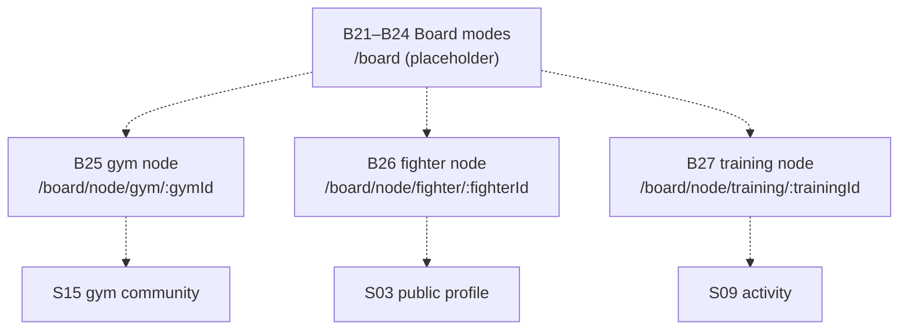

| Destination                               | Route id                                  | Path                               | Parent         | Deep link | Auth          | Context | Backend                                  | States | Implemented | Design ref         |
| ----------------------------------------- | ----------------------------------------- | ---------------------------------- | -------------- | --------- | ------------- | ------- | ---------------------------------------- | ------ | ----------- | ------------------ |
| Board (journey, timeline, places, people) | `mobile.board`                            | `/board`                           | — (tab root)   | Y         | AUTHENTICATED | FIGHTER | none (registry `api.get.board` DEFERRED) | none   | BLOCKED     | B21, B22, B23, B24 |
| Gym node                                  | `mobile.board.node.gym._gym-id`           | `/board/node/gym/:gymId`           | `mobile.board` | Y         | AUTHENTICATED | FIGHTER | none                                     | none   | BLOCKED     | B25                |
| Fighter node                              | `mobile.board.node.fighter._fighter-id`   | `/board/node/fighter/:fighterId`   | `mobile.board` | Y         | AUTHENTICATED | FIGHTER | none                                     | none   | BLOCKED     | B26                |
| Training node                             | `mobile.board.node.training._training-id` | `/board/node/training/:trainingId` | `mobile.board` | Y         | AUTHENTICATED | FIGHTER | none                                     | none   | BLOCKED     | B27                |

## 4. Community

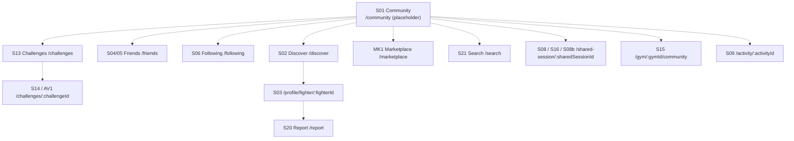

| Destination           | Route id                                                                                                                                    | Path                                                                                                       | Parent                              | Deep link                 | Auth          | Context      | Backend                                 | States | Implemented       | Design ref               |
| --------------------- | ------------------------------------------------------------------------------------------------------------------------------------------- | ---------------------------------------------------------------------------------------------------------- | ----------------------------------- | ------------------------- | ------------- | ------------ | --------------------------------------- | ------ | ----------------- | ------------------------ |
| Community home        | `mobile.community`                                                                                                                          | `/community`                                                                                               | — (tab root)                        | Y                         | AUTHENTICATED | FIGHTER      | none (registry `api.get.feed` DEFERRED) | none   | BLOCKED           | S01, AV2, AV2b           |
| Discover              | `mobile.discover`                                                                                                                           | `/discover`                                                                                                | —                                   | Y                         | AUTHENTICATED | FIGHTER      | none                                    | none   | BLOCKED           | S02                      |
| Public profile        | `mobile.profile.fighter._fighter-id`                                                                                                        | `/profile/fighter/:fighterId`                                                                              | `mobile.profile`                    | Y                         | AUTHENTICATED | FIGHTER      | none                                    | none   | BLOCKED           | S03                      |
| Friends               | `mobile.friends`                                                                                                                            | `/friends`                                                                                                 | —                                   | Y                         | AUTHENTICATED | FIGHTER      | none                                    | none   | BLOCKED           | S04, S05                 |
| Following             | `mobile.following`                                                                                                                          | `/following`                                                                                               | —                                   | Y                         | AUTHENTICATED | FIGHTER      | none                                    | none   | BLOCKED           | S06                      |
| Activity              | `mobile.activity._activity-id`                                                                                                              | `/activity/:activityId`                                                                                    | —                                   | Y                         | AUTHENTICATED | FIGHTER      | none                                    | none   | BLOCKED           | S09                      |
| Shared session        | `mobile.shared-session._shared-session-id`                                                                                                  | `/shared-session/:sharedSessionId`                                                                         | —                                   | Y                         | AUTHENTICATED | FIGHTER      | none                                    | none   | BLOCKED           | S16, S08, S08b           |
| Achievements          | `mobile.achievements`                                                                                                                       | `/achievements`                                                                                            | —                                   | Y                         | AUTHENTICATED | FIGHTER      | none                                    | none   | BLOCKED           | S11                      |
| Achievement           | `mobile.achievements._achievement-id`                                                                                                       | `/achievements/:achievementId`                                                                             | `mobile.achievements`               | Y                         | AUTHENTICATED | FIGHTER      | none                                    | none   | BLOCKED           | S12                      |
| Challenges            | `mobile.challenges`                                                                                                                         | `/challenges`                                                                                              | —                                   | Y                         | AUTHENTICATED | FIGHTER      | none                                    | none   | BLOCKED           | S13                      |
| Challenge             | `mobile.challenges._challenge-id`                                                                                                           | `/challenges/:challengeId`                                                                                 | `mobile.challenges`                 | Y                         | AUTHENTICATED | FIGHTER      | none                                    | none   | BLOCKED           | S14, AV1                 |
| Gym community         | `mobile.gym._gym-id.community`                                                                                                              | `/gym/:gymId/community`                                                                                    | —                                   | Y                         | AUTHENTICATED | FIGHTER      | none                                    | none   | BLOCKED           | S15                      |
| Report / block        | `mobile.report`                                                                                                                             | `/report`                                                                                                  | —                                   | Y                         | AUTHENTICATED | FIGHTER      | none (D-SA32)                           | none   | BLOCKED           | S20                      |
| Search                | `mobile.search`                                                                                                                             | `/search`                                                                                                  | —                                   | Y                         | AUTHENTICATED | session only | none                                    | none   | BLOCKED           | S21                      |
| Find sparring         | `mobile.sparring.find`                                                                                                                      | `/sparring/find`                                                                                           | —                                   | N (lands on `+not-found`) | AUTHENTICATED | FIGHTER      | none                                    | none   | FUTURE (DEFERRED) | S22                      |
| Marketplace           | `mobile.marketplace`                                                                                                                        | `/marketplace`                                                                                             | —                                   | Y                         | AUTHENTICATED | FIGHTER      | none (D-SA21)                           | none   | BLOCKED           | MK1, MK2, MK4, MK6, MK10 |
| Coach / gym / program | `mobile.marketplace.coach._coach-id`, `mobile.marketplace.gym._gym-id`, `mobile.marketplace.program._program-id`                            | `/marketplace/coach/:coachId`, `/marketplace/gym/:gymId`, `/marketplace/program/:programId`                | `mobile.marketplace`                | Y                         | AUTHENTICATED | FIGHTER      | none                                    | none   | BLOCKED           | MK3, MK5, MK7            |
| Events                | `mobile.events._event-id`, `mobile.events._event-id.register`                                                                               | `/events/:eventId`, `/events/:eventId/register`                                                            | —, `mobile.events._event-id`        | Y                         | AUTHENTICATED | FIGHTER      | none                                    | none   | BLOCKED           | MK11, MK12               |
| Gym store             | `mobile.gym._gym-id.store`, `mobile.store.product._product-id`, `mobile.store.cart`, `mobile.store.orders`, `mobile.store.orders._order-id` | `/gym/:gymId/store`, `/store/product/:productId`, `/store/cart`, `/store/orders`, `/store/orders/:orderId` | `mobile.store.orders` for the order | Y                         | AUTHENTICATED | FIGHTER      | none                                    | none   | BLOCKED           | SH1–SH3, SH5–SH7         |

## 5. Profile

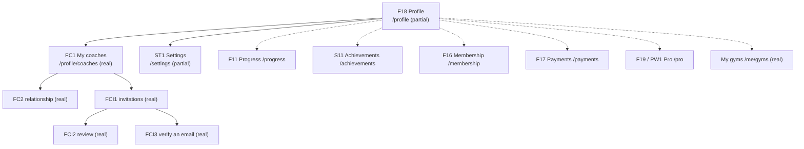

| Destination         | Route id                                                                                                                                                                       | Path                                         | Parent                                                               | Deep link | Auth          | Context                   | Backend                                            | States                        | Implemented                                 | Design ref               |
| ------------------- | ------------------------------------------------------------------------------------------------------------------------------------------------------------------------------ | -------------------------------------------- | -------------------------------------------------------------------- | --------- | ------------- | ------------------------- | -------------------------------------------------- | ----------------------------- | ------------------------------------------- | ------------------------ |
| Profile             | `mobile.profile`                                                                                                                                                               | `/profile`                                   | — (tab root)                                                         | Y         | AUTHENTICATED | FIGHTER                   | none called                                        | none                          | PARTIAL                                     | F18                      |
| My coaches          | `mobile.profile.coaches`                                                                                                                                                       | `/profile/coaches` (`?view=ended`)           | `mobile.profile`                                                     | Y         | AUTHENTICATED | FIGHTER                   | `listMyCoaches`                                    | loading, empty, 404, error    | IMPLEMENTED                                 | FC1                      |
| Coach relationship  | `mobile.profile.coaches._relationship-id`                                                                                                                                      | `/profile/coaches/:relationshipId`           | `mobile.profile.coaches`                                             | Y         | AUTHENTICATED | FIGHTER                   | `getMyCoachRelationship`, `endMyCoachRelationship` | pending, error, not available | IMPLEMENTED                                 | FC2                      |
| Coach invitations   | `mobile.profile.coaches.invitations`                                                                                                                                           | `/profile/coaches/invitations`               | `mobile.profile.coaches`                                             | Y         | AUTHENTICATED | FIGHTER                   | `listMyIncomingCoachInvitations`                   | skeleton, empty, 404, error   | IMPLEMENTED                                 | FCI1                     |
| Invitation review   | `mobile.profile.coaches.invitations._invitation-id`                                                                                                                            | `/profile/coaches/invitations/:invitationId` | `mobile.profile.coaches.invitations`                                 | Y         | AUTHENTICATED | FIGHTER                   | preview/accept/decline ops                         | skeleton, error, pending      | IMPLEMENTED                                 | FCI2                     |
| Verify an email     | `mobile.profile.coaches.invitations.verify-email`                                                                                                                              | `/profile/coaches/invitations/verify-email`  | `mobile.profile.coaches.invitations`                                 | Y         | AUTHENTICATED | FIGHTER                   | email identity ops                                 | code steps, resend countdown  | IMPLEMENTED                                 | FCI3                     |
| Progress            | `mobile.progress`                                                                                                                                                              | `/progress`                                  | —                                                                    | Y         | AUTHENTICATED | FIGHTER                   | none                                               | none                          | BLOCKED                                     | F11                      |
| Membership          | `mobile.membership`                                                                                                                                                            | `/membership`                                | —                                                                    | Y         | AUTHENTICATED | FIGHTER                   | member products (grant nothing)                    | none                          | BLOCKED                                     | F16                      |
| Payments            | `mobile.payments`                                                                                                                                                              | `/payments`                                  | —                                                                    | Y         | AUTHENTICATED | FIGHTER                   | none                                               | none                          | BLOCKED                                     | F17                      |
| Pro                 | `mobile.pro`                                                                                                                                                                   | `/pro`                                       | —                                                                    | Y         | AUTHENTICATED | FIGHTER                   | none                                               | none                          | BLOCKED                                     | F19, PW1                 |
| Member subscription | `mobile.me.membership`                                                                                                                                                         | `/me/membership`                             | —                                                                    | Y         | AUTHENTICATED | FIGHTER                   | `listMyProductSubscriptions` (unused)              | none                          | BLOCKED                                     | GC5, GC12                |
| Credits             | `mobile.me.credits`                                                                                                                                                            | `/me/credits`                                | —                                                                    | Y         | AUTHENTICATED | FIGHTER                   | none                                               | none                          | BLOCKED                                     | GC7                      |
| My gyms             | `mobile.me.gyms`                                                                                                                                                               | `/me/gyms`                                   | —                                                                    | Y         | AUTHENTICATED | session only              | gym membership ops                                 | yes                           | IMPLEMENTED (no fighter-mobile board; MMG1) | —                        |
| Settings hub        | `mobile.settings`                                                                                                                                                              | `/settings`                                  | —                                                                    | Y         | AUTHENTICATED | session only              | `logout`                                           | n/a                           | PARTIAL                                     | ST1                      |
| Settings children   | `mobile.settings.account`, `.security`, `.profile`, `.privacy`, `.notifications`, `.blocked`, `.training`, `.apps`, `.billing`, `.data`, `.delete`, `.delete.confirm`, `.help` | `/settings/…`                                | `mobile.settings` (`.delete.confirm` under `mobile.settings.delete`) | Y         | AUTHENTICATED | session only              | see [Artifact B](b-screen-to-code.md)              | none                          | MISSING or BLOCKED                          | ST2–ST11, ST13, S18, S19 |
| Pending deletion    | `mobile.account.pending-deletion`                                                                                                                                              | `/account/pending-deletion`                  | —                                                                    | Y         | AUTHENTICATED | session only (restricted) | none                                               | none                          | BLOCKED                                     | ST12                     |
| Suspended           | `mobile.account.suspended`                                                                                                                                                     | `/account/suspended`                         | —                                                                    | Y         | AUTHENTICATED | session only (restricted) | `account_suspended` error only                     | none                          | MISSING                                     | ST14                     |
| Appeal              | `mobile.account.appeal`                                                                                                                                                        | `/account/appeal`                            | —                                                                    | Y         | AUTHENTICATED | session only              | none                                               | none                          | BLOCKED                                     | ST15                     |

## Key flows

### Training completion (built, SF-66)

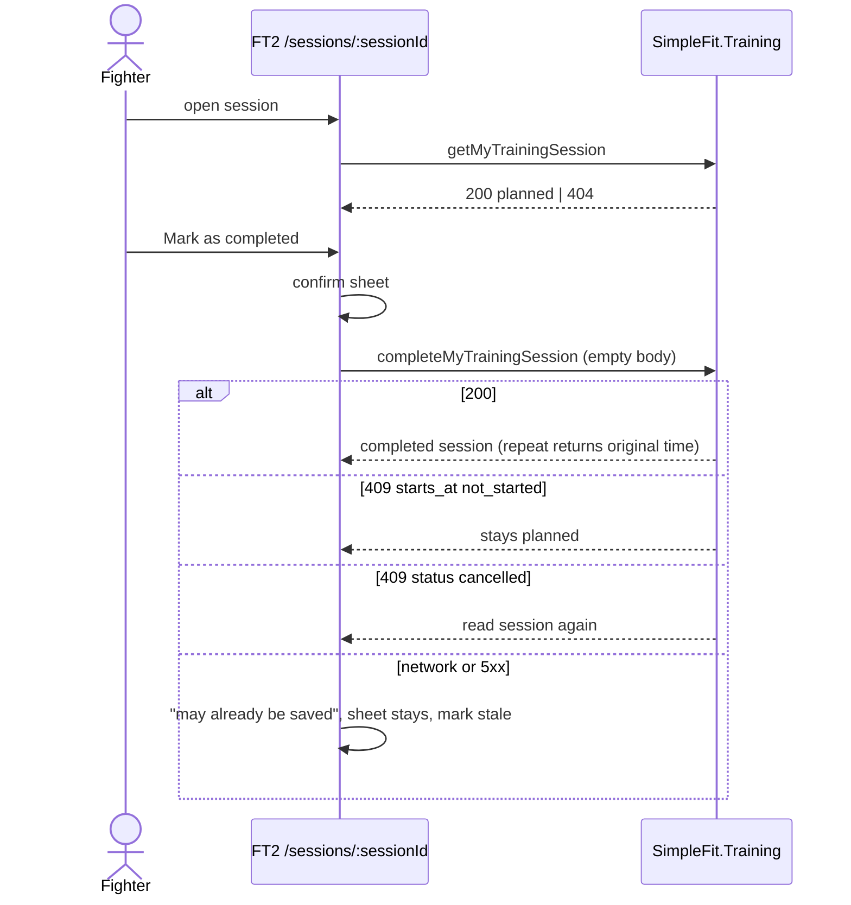

### Coach invitations (built, SF-76/SF-79)

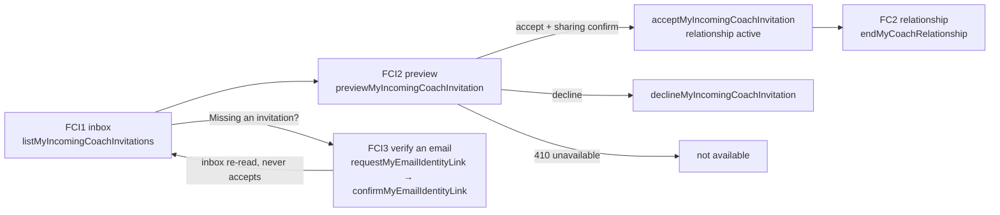

Activation is gated by `COACHING_ACCESS_ENABLED` (default `false`). While off,
previews and accepts answer `not_found`; the fighter's coach list and ending
stay available.

### Settings and account lifecycle (design; mostly blocked)

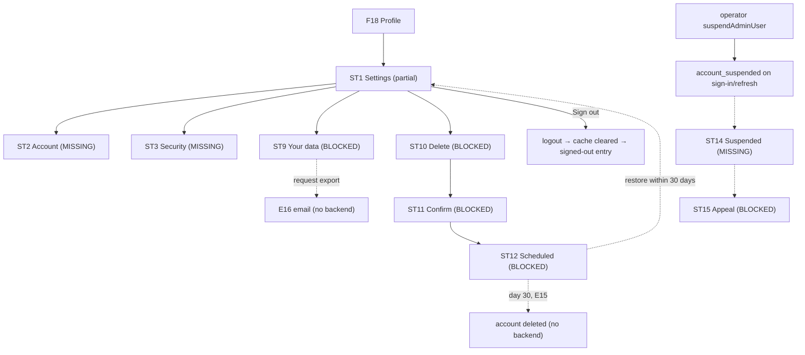

### Boxing timer phases (client-only; design T01–T06)

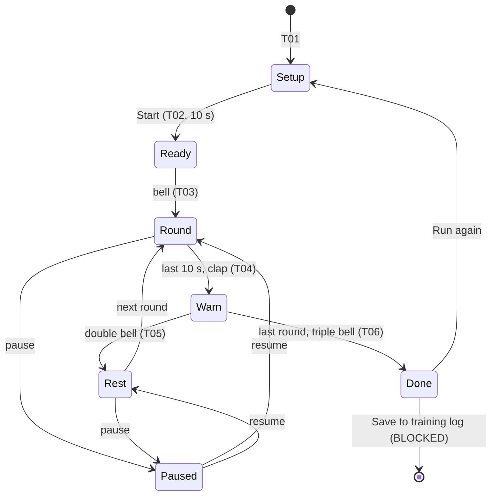

FlowTimer says "Any phase: pause · skip · reset". The behaviour with a 0:00
rest is UNVERIFIED in the prototype; the requirement is in
[Artifact I](i-roadmap.md#boxing-timer-requirements).

### Commerce checkout (design; all blocked)

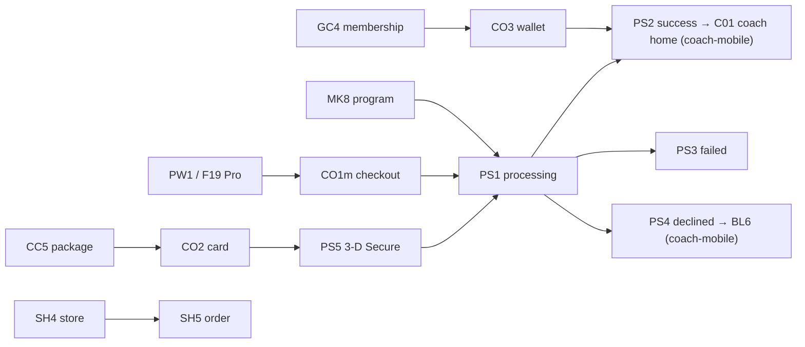

All of these use `mobile.checkout` `/checkout`, a placeholder with registry
`session = PUBLIC` (D-GUEST-CHECKOUT). No fighter checkout operation exists.

## Context and account switching safety

| Event                                                   | What happens today                                                                                                                                                                                                     | Evidence                                                                                                  | Risk                                                                                                                            |
| ------------------------------------------------------- | ---------------------------------------------------------------------------------------------------------------------------------------------------------------------------------------------------------------------- | --------------------------------------------------------------------------------------------------------- | ------------------------------------------------------------------------------------------------------------------------------- |
| Sign-out                                                | `logout` with the refresh token, SecureStore token deleted, session boundary fires; `cancelQueries()` + `client.clear()`                                                                                               | `src/entities/session/model/session.ts`, `src/providers/session-cache.ts` (test `session-cache.test.tsx`) | Low.                                                                                                                            |
| New sign-in on the device                               | Same session boundary: cache cancelled and cleared before the new state is published                                                                                                                                   | `src/providers/session-cache.ts`                                                                          | Low.                                                                                                                            |
| Refresh of the same session, or `unavailable` (offline) | Cache kept                                                                                                                                                                                                             | `src/providers/session-cache.ts` comment                                                                  | Low.                                                                                                                            |
| Context switch Fighter ↔ Coach ↔ Gym (same account)     | `chooseMyEntryContext`, entry re-resolved, then (SF-160) `crossWorkspaceBoundary`: cache cancelled and cleared, late calls discarded, new entry kept; `router.replace`. On failure only the entry query is invalidated | `src/features/session-gate/ui/context-switch.ts`, `src/entities/session/model/session.ts`                 | Low since SF-160 (was **Risk**, D-SF159-12). Tested in `router.test.tsx` and the real API ([SF-160](sf-160-five-tab-shell.md)). |
| Context persistence                                     | Server-side only (`entry_context_choices`); device stores only `locale` and `theme`                                                                                                                                    | `src/shared/storage/preferences.ts`                                                                       | Low.                                                                                                                            |
| Persisted query cache                                   | None (no `persistQueryClient`)                                                                                                                                                                                         | `src/shared/api/query-client.ts`                                                                          | Low; nothing survives an app restart.                                                                                           |
| Sensitive HTTP cache                                    | iOS native module configures the `expo/fetch` URL cache for sensitive responses                                                                                                                                        | `modules/sensitive-http-cache`, `native-http-cache.test.ts`                                               | Android behaviour UNVERIFIED.                                                                                                   |
| Suspension while signed in                              | Suspension revokes every session: the next call is 401, refresh rejected, the session ends ("Your session ended"). A new email-code, Google or Apple sign-in shows that the account is suspended (SF-160)              | backend `sessions.ex`, `restrictions.ex`; mobile `code-step.ts`, sign-in buttons                          | Handled at sign-in since SF-160; ST14/ST15 still open (D-SF160-03).                                                             |
