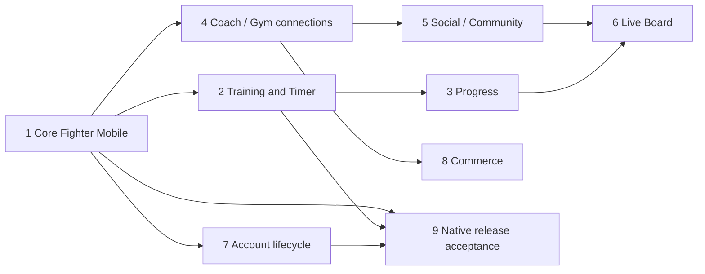

# I. Roadmap (SF-159)

A dependency-aware order for the rest of Fighter Mobile. It is a proposal
derived from the verified evidence in Artifacts A–H, not a Jira plan (Jira was
not readable, [Artifact G](g-jira-reconciliation.md)).

Legend for **Start**:

- **Now**: no new backend, ADR or legal decision needed.
- **After decision**: needs a decision in [Artifact H](h-decisions-blockers.md).
- **After backend**: needs a new `simplefit-api` domain or contract first.
- **Not in MVP**: blocked by an approved decision.

## Order at a glance

## 1. Core Fighter Mobile

| Item                                                                                                                | Artboards                         | Backend                                                                                   | Start                              | Notes                                                                                                        |
| ------------------------------------------------------------------------------------------------------------------- | --------------------------------- | ----------------------------------------------------------------------------------------- | ---------------------------------- | ------------------------------------------------------------------------------------------------------------ |
| Restricted-account handling: map `account_suspended` (and pending deletion once it exists) to the restricted routes | ST14 (`mobile.account.suspended`) | Exists (`account_suspended` on sign-in and refresh)                                       | Now (copy after D-SF159-11)        | Mobile code: `apiFetch`/session error mapping; `SessionGate` currently does not resolve restricted accounts. |
| Generic handling for `enrollment_required`, `invitation_recipient_mismatch`, `revision_conflict`                    | FCI2, F13                         | Exists                                                                                    | Now                                | D-SF159-22.                                                                                                  |
| Profile tab with real identity                                                                                      | F18                               | `getMyFighterProfile`                                                                     | Now                                | Keep rows for blocked domains out or as "Planned"; add tests (D-SF159-26).                                   |
| Settings hub                                                                                                        | ST1                               | none for the hub                                                                          | Now                                | Rows only to built children; add the existing locale and theme selectors.                                    |
| Account details                                                                                                     | ST2                               | `getMyAccountProfile`, `updateMyAccountProfile`, `listMyEmailIdentities`                  | Now                                | DOB read-only. No handle, phone or region.                                                                   |
| Sign-in and security                                                                                                | ST3                               | `getMyPasswordStatus`, `changeMyPassword`, `requestPasswordReset`, `confirmPasswordReset` | After decision D-SF159-10          | Design predates SF-157.                                                                                      |
| Edit profile                                                                                                        | ST4                               | `updateMyFighterProfile`                                                                  | Now (fields that exist)            | No photo (ADR 0015 deferred).                                                                                |
| Help and legal                                                                                                      | ST13                              | `getLegalDocument`                                                                        | Now (links); documents unpublished | No support chat.                                                                                             |
| Context-switch cache rule                                                                                           | —                                 | none                                                                                      | After decision D-SF159-12          | Small change in `context-switch.ts`.                                                                         |
| Home tab target                                                                                                     | F01 vs FR4                        | none                                                                                      | After decision D-SF159-09          | Code keeps FR4 meanwhile.                                                                                    |

## 2. Training and Timer

| Item                                            | Artboards                                                   | Backend                                                                  | Start                                                  | Notes                                                                                                                       |
| ----------------------------------------------- | ----------------------------------------------------------- | ------------------------------------------------------------------------ | ------------------------------------------------------ | --------------------------------------------------------------------------------------------------------------------------- |
| Boxing timer, client-only                       | T01, T02–T06 phases, T03, T04, FR6, ST6 (timer preferences) | None                                                                     | **Now**                                                | See [requirements](#boxing-timer-requirements). Needs justified dependencies (D-SF159-23) and local-data rule (D-SF159-13). |
| Timer entry from Training                       | FT1 → T01                                                   | None                                                                     | Now                                                    | FT1 design has a T01 link.                                                                                                  |
| Save timer workout, T06 RPE                     | T01 done, F06                                               | Timer-log / training-log domain (`api.post.timer-rounds-batch` DEFERRED) | After decision D-SF159-14 and D-SF159-05, then backend | Keep local mechanics separate from any backend record.                                                                      |
| Live training, session log, plan, hub, calendar | F04, F05, F06, F24, F12                                     | New domains                                                              | FUTURE                                                 | Labels preserved.                                                                                                           |
| Share training                                  | S07                                                         | Social domain                                                            | After backend                                          | Depends on group 5.                                                                                                         |

## 3. Progress

| Item                      | Artboards     | Backend                           | Start                                   | Notes                                            |
| ------------------------- | ------------- | --------------------------------- | --------------------------------------- | ------------------------------------------------ |
| Progress, sparring, video | F11, F09, F10 | Metrics, sparring, uploads, video | After backend                           | Derived from training, timer logs and check-ins. |
| Fight camp, weight        | F07, F08      | Camp and weight-history domain    | After decision D-SF159-05, then backend | Owner-only body data (D-SF159-01).               |
| Achievements, challenges  | S11–S14       | Needs timer logs and social       | After backend                           |                                                  |

## 4. Coach / Gym connections

| Item                                          | Artboards          | Backend                   | Start                                           | Notes                                         |
| --------------------------------------------- | ------------------ | ------------------------- | ----------------------------------------------- | --------------------------------------------- |
| Coaches and invitations                       | FC1–FCI3           | Exists                    | Done (SF-59, SF-76, SF-79)                      | Coaching gate off by default; counsel (L-16). |
| My gyms, join, gym invitations, class booking | F13, MMG1–MMG4     | Exists (SF-99, SF-135)    | Done (SF-100, SF-135); F13 extras after backend | Credits and waitlist are FUTURE in SF-99.     |
| Gym member products (list, request, cancel)   | F16, GC1, GC3, GC5 | Exists but grants nothing | After decision D-SF159-16                       | No purchase wording.                          |
| Member pass                                   | F16                | D-G19 proposed            | After backend                                   |                                               |
| Coach services, PT booking                    | CC3, CC4, CC5      | New domain                | After backend; commerce NO-GO                   |                                               |

## 5. Social / Community

| Item                                                                                           | Artboards          | Backend                 | Start                                   | Notes                             |
| ---------------------------------------------------------------------------------------------- | ------------------ | ----------------------- | --------------------------------------- | --------------------------------- |
| Friends, following, discover, public profile, activity, shared sessions, gym community, search | S01–S16, S08b, S21 | New social domain       | After decision D-SF159-15, then backend | D-SF159-04: no moderation domain. |
| Messaging                                                                                      | F14, F15           | New domain              | After decision D-SF159-18               |                                   |
| Notifications inbox and settings                                                               | S17, S18, F01b     | Push + preferences      | After decision D-SF159-20               |                                   |
| Privacy settings                                                                               | S19                | Privacy-settings domain | After decision D-SF159-15               |                                   |
| Report, block                                                                                  | S20, ST5           | —                       | Not in MVP (D-SA32)                     |                                   |
| Sparring finder                                                                                | S22                | —                       | FUTURE (DEFERRED)                       |                                   |

## 6. Live Board

| Item                        | Artboards | Backend                                     | Start                                     | Notes                                      |
| --------------------------- | --------- | ------------------------------------------- | ----------------------------------------- | ------------------------------------------ |
| Board modes and node sheets | B21–B27   | Board domain on training, check-ins, social | After groups 3 and 5, decision D-SF159-19 | Centre tab stays a placeholder until then. |

## 7. Account lifecycle

| Item                         | Artboards        | Backend    | Start                                                                       | Notes                  |
| ---------------------------- | ---------------- | ---------- | --------------------------------------------------------------------------- | ---------------------- |
| Suspended notice             | ST14             | Exists     | Now (see group 1)                                                           |                        |
| Appeal                       | ST15             | New        | Not in MVP until counsel (D-SA29)                                           |                        |
| Data export                  | ST9              | New        | After decision D-SF159-17 (D-SA17, proposed, would exclude it from the MVP) | Design gap D-SF159-33. |
| Account deletion and restore | ST10, ST11, ST12 | New (L-09) | After decision D-SF159-17                                                   | Gym owner guard D-G26. |

## 8. Commerce

| Item                                            | Artboards                             | Backend          | Start                                                   | Notes                    |
| ----------------------------------------------- | ------------------------------------- | ---------------- | ------------------------------------------------------- | ------------------------ |
| Fighter Pro, checkout, payment states           | F19, PW1, CO1m–CO4, PS1–PS5, ST8, F17 | Consumer billing | Not planned for MVP (D-SA23 proposed); production NO-GO | Design fixes D-SF159-37. |
| Gym member billing UI                           | GC4, GC7, GC8, GC12                   | Member checkout  | Only after decisions D-SF159-16 and D-SF159-42          |                          |
| Programs, events, marketplace, store, sponsored | MK1–MK12, SH1–SH7, AV1–AV2b           | —                | Not in MVP (D-SA21 approved; D-SA23 proposed)           |                          |

## 9. Native release acceptance

| Item                                                                                             | Start            | Notes                                                                      |
| ------------------------------------------------------------------------------------------------ | ---------------- | -------------------------------------------------------------------------- |
| Design QA per screen at 390 × 844 pt (`docs/design-handoff.md` §11)                              | With each screen | Required in every UI PR.                                                   |
| Timer on physical iOS and Android devices: lock screen, background, interruptions, audio session | With group 2     | Simulators do not prove background audio.                                  |
| Restricted-account and sign-out cache checks                                                     | With group 1     | Extend `session-cache.test.tsx` style tests.                               |
| Deep links `simplefit://<path>` for every built route; universal links for invites               | With each screen | No E2E framework exists (no Maestro or Detox); decide whether to add one.  |
| `pnpm quality`                                                                                   | Always           | CI runs lint, format, typecheck, tests, `api:check`, Expo checks, bundles. |

## Parallel tracks

| Track                                                    | Can run in parallel with | Why                                                |
| -------------------------------------------------------- | ------------------------ | -------------------------------------------------- |
| Mobile: timer (group 2, client-only)                     | Everything               | No backend.                                        |
| Mobile: group 1 (profile, settings, restricted accounts) | Timer; any backend track | Uses existing ops.                                 |
| Backend: training-log / timer-log contract               | Mobile timer             | Mobile keeps local mechanics; save is added later. |
| Backend + counsel: health-data ADR (D-SF159-05)          | All mobile work          | Gates groups 3 and parts of 2.                     |
| Backend + product: social model and notifications ADRs   | Groups 1–2               | Gate groups 5–6.                                   |
| Docs: registry resync platform ↔ mobile (D-SF159-25)     | Everything               | Must land before any registry edit.                |
| Design: fix gaps D-SF159-30..37, 43, 44                  | Everything               | Owned by the design owner.                         |

## Boxing timer requirements

Derived from `TimerLive.dc.html` (T01), `FlowTimer.dc.html` and
`SetTraining.dc.html` (ST6). The prototype uses Web Audio tones and
`speechSynthesis`; the native app needs its own audio. Nothing here needs the
backend.

### Presets and limits (FlowTimer)

| Preset    | Rounds | Round                          | Rest      |
| --------- | ------ | ------------------------------ | --------- |
| Pro       | 12     | 3:00                           | 1:00      |
| Amateur   | 3      | 3:00                           | 1:00      |
| Heavy bag | 10     | 2:00                           | 0:30      |
| Sparring  | 6      | 2:00                           | 1:00      |
| Tabata    | 8      | 0:20                           | 0:10      |
| Custom    | 1–30   | 0:15–10:00 (T01 steps of 15 s) | 0:00–5:00 |

T01 defaults: 12 rounds × 180 s, 60 s rest, 10 s get-ready, warning at the
last 10 s. ST6 shows the default preset "Pro 12 × 3:00 / 1:00".

### Phases

`setup` → `ready` (10 s, T02) → `round` (T03) → `warn` (last 10 s, T04) →
`rest` (T05) → next `round` … → `done` (T06). "Any phase: pause · skip ·
reset". Done offers "Run again" and "Save to training log" (the latter BLOCKED,
D-SF159-14).

### Sounds and cues (FlowTimer)

- Bell at round start.
- Double bell into rest.
- Triple bell at the end.
- Clap at the last 10 s (toggle "Last-10 s clap").
- Three beeps before each round.
- Optional voice combo calls every 10 s (T01 "Combo callouts · Voice").
- ST6 adds haptics and keep-awake toggles; voice "English · male".

### Engineering requirements

1. **Time accuracy.** Derive remaining time from a monotonic clock and the
   phase start timestamp, never by counting ticks. A late or dropped tick must
   not drift the timer. Cue times are computed from the same timestamps.
2. **Foreground.** The display updates at least once per second; phase changes
   and cues fire on time even if a frame is late. Keep the screen awake while
   running when the ST6 toggle is on.
3. **Background and lock screen.** The timer keeps correct time when the app
   is backgrounded or the phone locks: on return, recompute the phase from
   timestamps. Cues while in the background need native audio or scheduled
   local notifications; which one is a technical decision (needs dependency
   justification, D-SF159-23) and must be proven on physical devices.
4. **Interruptions.** Phone calls, other audio, Siri and alarms pause or duck
   audio according to the platform audio session; after the interruption the
   timer state is still derived from timestamps. Define whether an interruption
   pauses the timer (UNVERIFIED in the design; product to confirm).
5. **Suspension and process death.** Persist the running session (preset,
   phase start timestamps, paused state) locally so a killed app can restore or
   cleanly end the workout. Whether this local state survives sign-out or an
   account switch is D-SF159-13.
6. **Notifications and haptics.** Optional haptic per cue; local notifications
   only if background audio is not used. No push and no backend.
7. **Accessibility.** Colour is not the only phase signal (olive work, amber
   get-ready and last 10 s, bone rest): show the phase label and announce
   phase changes to screen readers. Pause button 92 px, reset and skip 64 px in
   the design (map through the token scale).
8. **Separation.** Local timer mechanics (state machine, audio, persistence)
   live in their own feature slice and never call the API. A future training
   or timer log consumes the finished workout summary through a separate
   feature once a contract exists.
9. **No invented data.** Do not store or show RPE, rounds totals or streaks on
   the server until D-SF159-05 and D-SF159-14 are decided.
